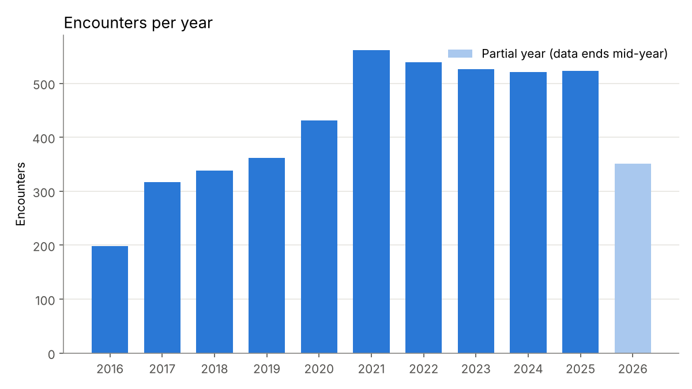
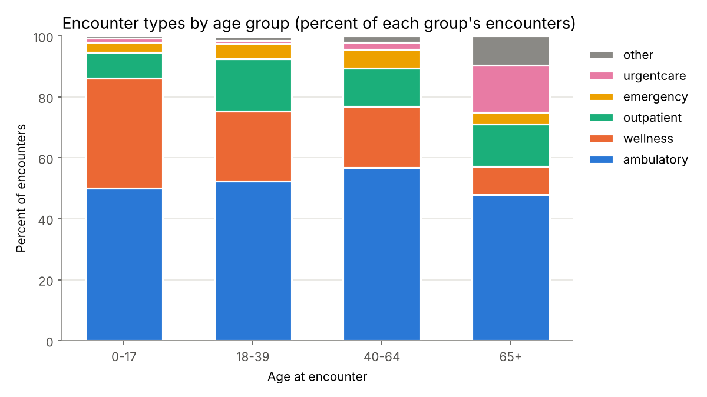
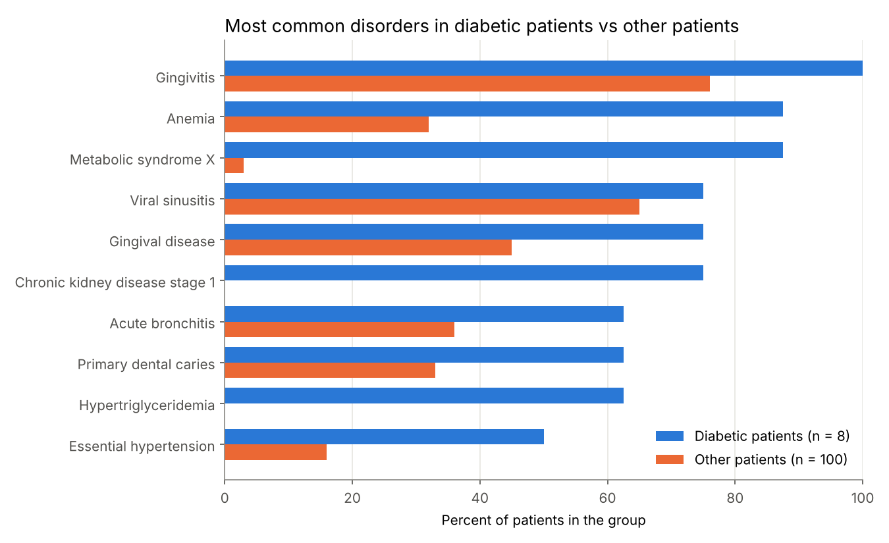
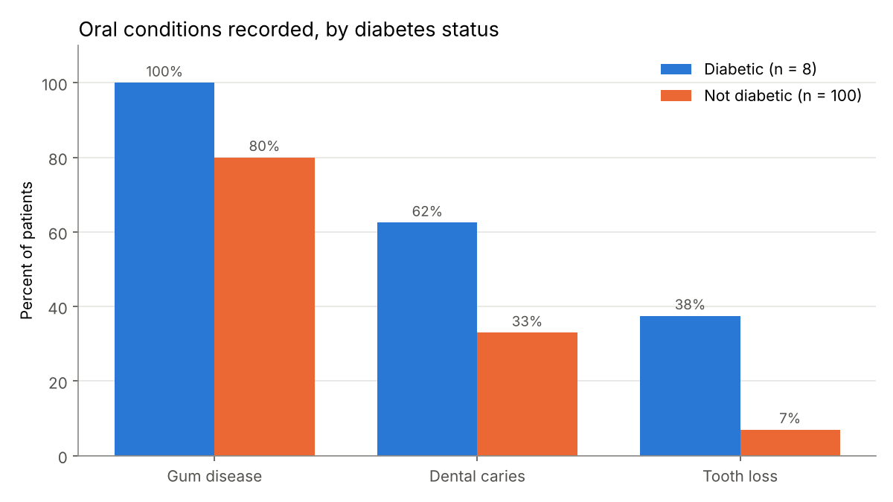

# Synthea EHR SQL: clinical questions answered with SQL on synthetic patient records

## The question

How common is diabetes in a synthetic patient population, how do these patients use care, and are oral conditions recorded more often alongside it?

## Why it matters

Electronic health records (EHRs) are stored as linked tables: patients, visits, diagnoses, prescriptions, and lab results. Most health informatics work starts with joining those tables to answer a clinical question. As a dentist, I am interested in the link between diabetes and periodontal disease: poorly controlled diabetes worsens gum disease, and periodontal inflammation can make glycemic control harder. A dental clinic that can see a patient's diabetes status and HbA1c can plan periodontal care and referrals better. This project practices exactly that kind of record linkage, using safe synthetic data.

## Data source

- **Synthea sample data (CSV)**, generated by Synthea, an open-source synthetic patient simulator from The MITRE Corporation.
- Repository: https://github.com/synthetichealth/synthea-sample-data
- File used: `downloads/latest/synthea_sample_data_csv_latest.zip`
- The data is fully synthetic. No real patients are included, so it can be shared publicly.
- Tables used: `patients`, `encounters`, `conditions`, `medications`, `observations`.
- The SHA-256 fingerprint of the exact file used is printed in [results/summary.md](results/summary.md), so anyone can check they have the same data. If Synthea updates the "latest" file, rerunning the project will give slightly different numbers; `results/summary.md` is regenerated on every run.

## How to run

You need Python 3.12 or newer (3.13 recommended; on a Mac, the pinned packages need macOS 14 Sonoma or newer).

Download or clone this repository, open a terminal in the project folder, and run the commands below.

**Mac (Terminal):**

```bash
python3 -m venv .venv
source .venv/bin/activate
pip install -r requirements.txt
python src/01_download_data.py
python src/02_load_to_sqlite.py
python src/03_run_queries.py
python src/04_make_charts.py
pytest
```

**Windows (PowerShell):**

```powershell
py -m venv .venv
.venv\Scripts\Activate.ps1
pip install -r requirements.txt
python src/01_download_data.py
python src/02_load_to_sqlite.py
python src/03_run_queries.py
python src/04_make_charts.py
pytest
```

If PowerShell blocks the activate script, run `Set-ExecutionPolicy -Scope CurrentUser RemoteSigned` once and try again.

| Script | What it does |
|---|---|
| `src/01_download_data.py` | Downloads the zip (3 attempts, clear error message on failure) and unzips the five tables into `data/raw/csv/` |
| `src/02_load_to_sqlite.py` | Loads the CSVs into `data/synthea.db` with pandas and adds indexes on patient IDs |
| `src/03_run_queries.py` | Runs every file in `sql/` in order, saves each result to `results/tables/`, and writes `results/summary.md` |
| `src/04_make_charts.py` | Draws four charts into `results/charts/` |

## Method

1. Loaded the five CSV tables into SQLite. All columns are read as text first so codes keep their leading zeros; only cost columns are converted to numbers.
2. Wrote 12 SQL queries, one question per file in `sql/`. Each file starts with the question and explains its definitions in comments.
3. **Diabetes definition:** a patient has diabetes if any condition description contains "diabetes mellitus". This includes type 2 diabetes and its complications (for example diabetic kidney disease) and excludes prediabetes. One patient in this data has diabetic complications recorded without a separate "type 2 diabetes" row, which is why complications are included.
4. **Age:** measured on the "snapshot date" (the last encounter date in the data, 2026-08-16) for living patients and on the date of death for deceased patients. Using a fixed date from the data instead of today's date makes the results reproducible.
5. **Latest HbA1c:** for each patient, the lab result (LOINC 4548-4) with the most recent date.
6. **Oral conditions:** gum disease = descriptions containing "gingiv" or "periodont"; caries = "dental caries"; tooth loss = "loss of teeth".

| File | Question |
|---|---|
| 01_patient_overview | How many patients, living or deceased, by sex, average age |
| 02_diabetes_prevalence | Share with diabetes and with prediabetes |
| 03_diabetes_by_age_group | Diabetes prevalence by age group |
| 04_visit_frequency | How many visits each patient has, in buckets |
| 05_encounters_per_year | Encounters per year over the last 11 years |
| 06_encounter_types | Mix of encounter classes (wellness, ambulatory, emergency, and so on) |
| 07_encounter_types_by_age_group | Encounter mix within each age group |
| 08_top_medications_diabetic | Top 10 medications among diabetic patients |
| 09_diabetes_comorbidities | Top disorders in diabetic patients compared with other patients |
| 10_latest_hba1c | Latest HbA1c by diabetes status, with a plausibility check |
| 11_oral_conditions_by_diabetes | Gum disease, caries, and tooth loss by diabetes status |
| 12_dental_visits_by_age_group | Dental-related encounters by age group |

## Top 3 findings

All numbers come from the run on October 17, 2026. Full tables are in [results/summary.md](results/summary.md).

1. **Diabetes is recorded for 8 of 108 patients (7.4%) and rises steeply with age:** 0% under 18, 2.6% at 18 to 39, 10.5% at 40 to 64, and 30.0% (3 of 10) at 65 and over. Another 34 patients (31.5%) have prediabetes. Insulin (5 patients) and metformin (4 patients) are the only medications in the diabetic top 10 that list diabetes as the reason; the rest treat other conditions.
2. **Oral conditions appear more often in diabetic patients:** gum disease in 8 of 8 diabetic patients (100%) versus 80 of 100 others (80%), dental caries in 62.5% versus 33.0%, and tooth loss in 37.5% versus 7.0%. With only 8 diabetic patients, and diabetic patients being older on average, this is a description of this dataset and not evidence of a causal link.
3. **The lab data has a realism problem worth catching:** diabetic patients have a lower average latest HbA1c (4.36%) than non-diabetic patients who were tested (6.07%), and 3 of 7 tested diabetic patients have a latest value below 4.0%, which is rare in real patients. This looks like an artifact of how Synthea simulates treatment. It is a reminder to check clinical plausibility before trusting any EHR extract.

## Charts









## Limitations

- **Synthetic data.** Synthea follows published disease models, but patterns are simulated. Findings describe the simulator, not a real population.
- **Small sample.** 108 patients and 8 with diabetes. Percentages in small groups move a lot when one patient changes.
- **No adjustment for age.** Diabetic patients are older, and tooth loss rises with age, so the oral condition comparison is not age-adjusted.
- **Diagnosis by text match.** Conditions are found by matching words in descriptions, not by a full code list. A real study would use a validated code set (for example a SNOMED CT value set).
- **"Ever diagnosed."** Conditions are counted if they were ever recorded, including ones that later resolved.

## Tests

`pytest` runs 35 tests on a tiny hand-made dataset in `tests/fixtures/`, where the right answers are known in advance. They check the download retries and error messages, the CSV loading, every SQL query, the summary writer, and that each script stops with a clear message when its input is missing.

Built in October 2026.

Developed with AI-assisted coding; analysis decisions and interpretation are my own.
